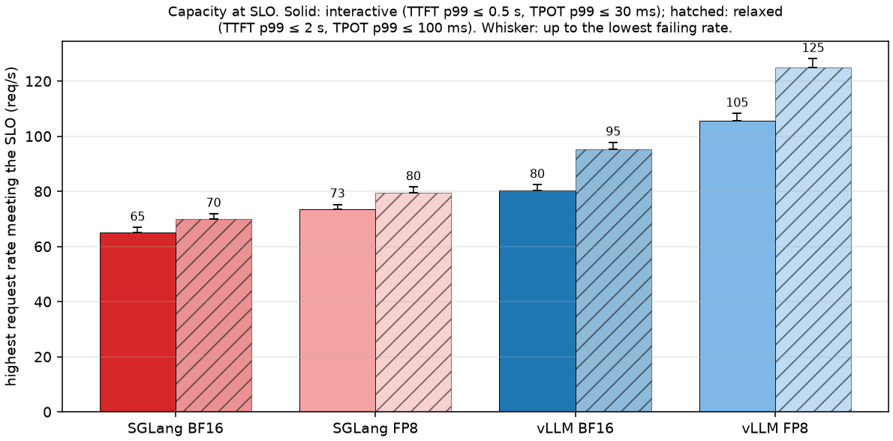
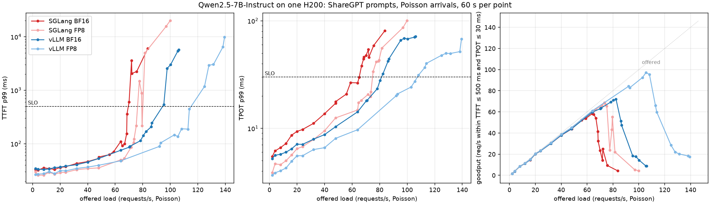
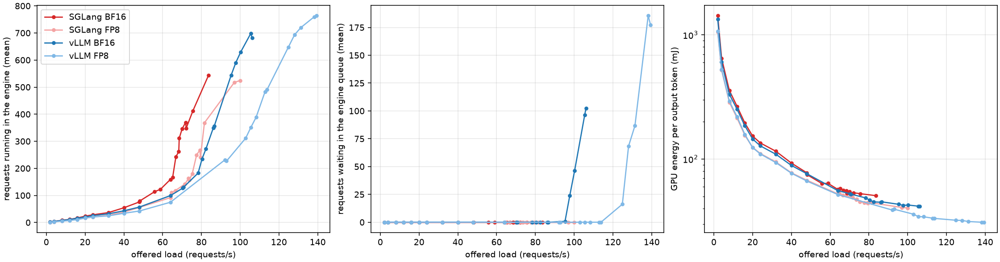
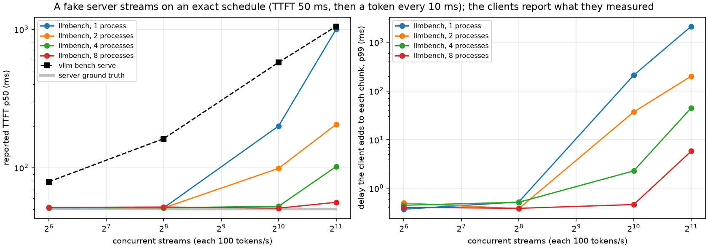
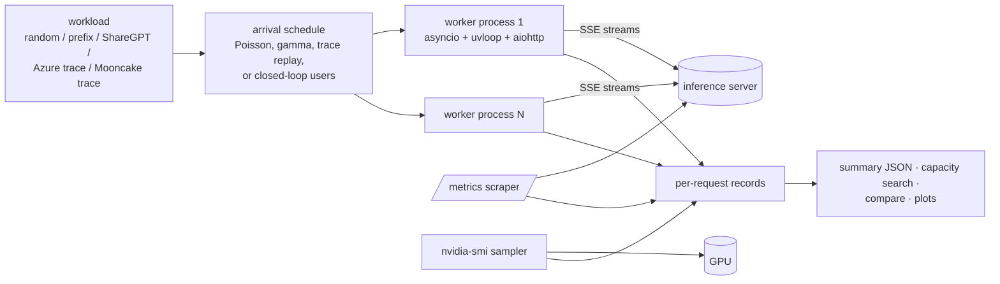

# llmbench: LLM inference benchmark suite

A load generator and benchmark harness for OpenAI-compatible inference servers (vLLM, SGLang,
TensorRT-LLM, TGI, llama.cpp, Ollama). It measures what callers experience (time to first token,
time per output token, inter-token latency, end-to-end latency, goodput) under realistic
open-loop traffic, searches for the highest request rate that still meets a latency SLO, records
the engine's own telemetry and the GPU's energy per token alongside, and checks how much error the
client adds to its own measurements.

<!-- BEGIN GENERATED: headline -->
- **Capacity of one H200 serving Qwen2.5-7B within an interactive SLO** (TTFT p99 ≤ 500 ms, TPOT p99 ≤ 30 ms, ShareGPT, Poisson arrivals): vLLM FP8 105 req/s (19,536 output tok/s); vLLM BF16 80 req/s (14,408 output tok/s); SGLang FP8 73 req/s (13,825 output tok/s); SGLang BF16 65 req/s (11,607 output tok/s).
- **FP8 (W8A8) raises interactive capacity +31% on vLLM and +13% on SGLang**, and lowers TPOT at every load.
- **A 2,000-request burst exposes a scheduling difference:** vLLM admits at most 1,021 requests at once and mixes decode tokens into every chunked-prefill batch, so streams keep moving (TPOT p99 183 ms); SGLang admits 1,955 and its TPOT p99 reaches 1,921 ms: its scheduler ran up to 49 prefill-only batches of 8,192 tokens back to back while 1,336 requests queued, and running streams got no tokens in between. Both at default settings.
- **Prefix caching is the difference between overload and comfort on real agent traffic:** replaying the Mooncake tool-agent trace at 2× speed, TTFT p99 goes SGLang 89 s → 1.7 s, vLLM 92 s → 1.8 s with caching on.
- **Benchmark clients can be the bottleneck:** against a server with a true 50 ms TTFT streaming to 1,024 clients, vLLM's own `vllm bench serve` reports 578 ms and a single llmbench process reports 200 ms median TTFT; with 8 processes llmbench reports 50.9 ms and its per-token timestamps stay within 0.5 ms (p99) of the server's.
<!-- END GENERATED: headline -->

## Results

<!-- BEGIN GENERATED: setup -->
One NVIDIA H200 (141 GB, driver 570.86.15) per engine, Intel Xeon Gold 6548Y+ host. vLLM 0.34.0 and SGLang 0.5.23 from their official container images, at default settings apart from an 8k context limit (SGLang also needs `--enable-metrics`). FP8 means each engine's `--quantization fp8`: weights and activations quantized on load, no calibration data. Model Qwen2.5-7B-Instruct. Client and engine share the node; the client runs 4 worker processes.
<!-- END GENERATED: setup -->

Every number below is generated by [`scripts/build_readme.py`](scripts/build_readme.py) from the
JSON files in [`results/`](results/); CI fails if the README and the results disagree. Figures
come from [`scripts/make_figures.py`](scripts/make_figures.py).

### Capacity at SLO

The question a capacity plan asks: how many requests per second can one GPU take before tail
latency breaks the SLO? Two MLPerf-style tiers on ShareGPT traffic with Poisson arrivals:
**interactive** (TTFT p99 ≤ 500 ms, TPOT p99 ≤ 30 ms) and **relaxed** (TTFT p99 ≤ 2 s, TPOT p99
≤ 100 ms). Each capacity is a bracket from a geometric bisection over 60-second probes: the
highest rate that passed and the lowest that failed. The search starts from the completion rate
of a 2,000-request burst, which bounds what the server can absorb at once; steady Poisson traffic
can run higher than a burst, so the search grows past it when the first probe passes.

<!-- BEGIN GENERATED: capacity -->
| engine | capacity, interactive SLO (req/s) | output tok/s there | capacity, relaxed SLO (req/s) | output tok/s there | 2,000-request burst (req/s) | KV cache (tokens) |
|---|---|---|---|---|---|---|
| SGLang BF16 | **65.2** (65.2–66.8) | 11,607 | **70.1** (70.1–71.9) | 12,222 | 48.1 | 2,084,724 |
| SGLang FP8 | **73.4** (73.4–75.2) | 13,825 | **79.5** (79.5–81.6) | 14,046 | 64.6 | 2,195,206 |
| vLLM BF16 | **80.3** (80.3–82.4) | 14,408 | **95.3** (95.3–97.7) | 15,769 | 70.7 | 2,241,536 |
| vLLM FP8 | **105.5** (105.5–108.2) | 19,536 | **124.9** (124.9–128.1) | 20,847 | 92.9 | 2,355,200 |
<!-- END GENERATED: capacity -->



### Latency vs. throughput



<!-- BEGIN GENERATED: sweep -->
| engine | offered req/s | achieved req/s | output tok/s | TTFT p50 / p99 (ms) | TPOT p50 / p99 (ms) | ITL p99 (ms) | goodput (req/s) | J / output token |
|---|---|---|---|---|---|---|---|---|
| SGLang BF16 | 16 | 14.7 | 3,057 | 17 / 33 | 5.6 / 8.6 | 19.5 | 14.7 | 0.195 |
| SGLang BF16 | 32 | 30.2 | 5,652 | 18 / 43 | 6.8 / 11.1 | 25.2 | 30.2 | 0.116 |
| SGLang BF16 | 48 | 43.9 | 8,746 | 22 / 53 | 9.1 / 17.1 | 41.1 | 43.8 | 0.077 |
| SGLang BF16 | 64 | 58.7 | 11,964 | 38 / 110 | 14.2 / 26.4 | 53.5 | 58.4 | 0.057 |
| SGLang BF16 | ∞ | 52.8 | 10,706 | 5,467 / 9,771 | 144.5 / 1,699.6 | 449.1 | 0.0 | 0.050 |
| SGLang FP8 | 16 | 15.1 | 3,153 | 15 / 27 | 3.9 / 5.6 | 13.3 | 15.1 | 0.155 |
| SGLang FP8 | 32 | 30.7 | 5,756 | 15 / 33 | 4.7 / 7.9 | 18.6 | 30.7 | 0.095 |
| SGLang FP8 | 48 | 45.1 | 8,983 | 19 / 35 | 6.5 / 12.5 | 29.0 | 45.1 | 0.067 |
| SGLang FP8 | 64 | 60.8 | 12,387 | 23 / 50 | 7.8 / 14.8 | 34.5 | 60.8 | 0.052 |
| SGLang FP8 | ∞ | 62.4 | 12,635 | 3,481 / 6,186 | 115.9 / 1,075.3 | 256.6 | 0.0 | 0.039 |
| vLLM BF16 | 16 | 14.7 | 3,062 | 18 / 36 | 5.3 / 6.4 | 11.1 | 14.7 | 0.185 |
| vLLM BF16 | 32 | 30.1 | 5,650 | 20 / 41 | 5.9 / 7.9 | 14.0 | 30.1 | 0.109 |
| vLLM BF16 | 48 | 44.0 | 8,766 | 24 / 53 | 6.8 / 10.3 | 18.0 | 44.0 | 0.076 |
| vLLM BF16 | 64 | 59.9 | 12,206 | 31 / 76 | 8.6 / 14.2 | 24.7 | 59.8 | 0.056 |
| vLLM BF16 | ∞ | 70.6 | 14,314 | 5,499 / 14,620 | 53.6 / 183.0 | 184.5 | 0.0 | 0.046 |
| vLLM FP8 | 16 | 15.2 | 3,161 | 14 / 28 | 3.6 / 4.9 | 8.8 | 15.2 | 0.158 |
| vLLM FP8 | 32 | 30.7 | 5,755 | 17 / 35 | 4.6 / 6.3 | 10.6 | 30.7 | 0.094 |
| vLLM FP8 | 48 | 45.2 | 9,009 | 20 / 40 | 4.9 / 8.1 | 12.0 | 45.2 | 0.066 |
| vLLM FP8 | 64 | 61.0 | 12,436 | 24 / 48 | 6.3 / 9.7 | 15.6 | 61.0 | 0.052 |
| vLLM FP8 | ∞ | 91.4 | 18,520 | 3,685 / 10,573 | 39.2 / 133.6 | 185.6 | 0.3 | 0.035 |
<!-- END GENERATED: sweep -->

Head-to-head at the same offered load. Each run's requests are resampled to put a confidence
interval on the difference, so small gaps that are within noise are not reported as wins:

<!-- BEGIN GENERATED: compare -->
| comparison | load | metric | baseline | candidate | change [95% CI] |
|---|---|---|---|---|---|
| SGLang vs vLLM, BF16 | 32 req/s | TTFT p50 | 20.1 ms | 18.1 ms | -10% [-13%, -7.8%] ** |
| SGLang vs vLLM, BF16 | 32 req/s | TTFT p99 | 40.7 ms | 42.8 ms | +5.3% [-7.6%, +14%] |
| SGLang vs vLLM, BF16 | 32 req/s | TPOT p50 | 5.9 ms | 6.8 ms | +16% [+15%, +17%] ** |
| SGLang vs vLLM, BF16 | 32 req/s | TPOT p99 | 7.9 ms | 11.0 ms | +39% [+27%, +57%] ** |
| SGLang vs vLLM, FP8 | 32 req/s | TTFT p50 | 17.2 ms | 15.2 ms | -11% [-14%, -9.2%] ** |
| SGLang vs vLLM, FP8 | 32 req/s | TTFT p99 | 34.5 ms | 32.7 ms | -5.2% [-20%, +1.6%] |
| SGLang vs vLLM, FP8 | 32 req/s | TPOT p50 | 4.6 ms | 4.7 ms | +3.2% [+2.8%, +3.8%] ** |
| SGLang vs vLLM, FP8 | 32 req/s | TPOT p99 | 6.3 ms | 7.8 ms | +24% [+13%, +37%] ** |
| vLLM FP8 vs BF16 | 32 req/s | TTFT p50 | 20.1 ms | 17.2 ms | -15% [-17%, -12%] ** |
| vLLM FP8 vs BF16 | 32 req/s | TTFT p99 | 40.7 ms | 34.5 ms | -15% [-25%, -1.3%] ** |
| vLLM FP8 vs BF16 | 32 req/s | TPOT p50 | 5.9 ms | 4.6 ms | -22% [-22%, -22%] ** |
| vLLM FP8 vs BF16 | 32 req/s | TPOT p99 | 7.9 ms | 6.3 ms | -20% [-27%, -13%] ** |
| SGLang FP8 vs BF16 | 32 req/s | TTFT p50 | 18.1 ms | 15.2 ms | -16% [-18%, -13%] ** |
| SGLang FP8 vs BF16 | 32 req/s | TTFT p99 | 42.8 ms | 32.7 ms | -24% [-32%, -17%] ** |
| SGLang FP8 vs BF16 | 32 req/s | TPOT p50 | 6.8 ms | 4.7 ms | -31% [-31%, -30%] ** |
| SGLang FP8 vs BF16 | 32 req/s | TPOT p99 | 11.0 ms | 7.8 ms | -29% [-37%, -21%] ** |
| SGLang vs vLLM, BF16 | 64 req/s | TTFT p50 | 31.3 ms | 37.5 ms | +20% [+17%, +22%] ** |
| SGLang vs vLLM, BF16 | 64 req/s | TTFT p99 | 75.6 ms | 109.9 ms | +45% [+31%, +56%] ** |
| SGLang vs vLLM, BF16 | 64 req/s | TPOT p50 | 8.6 ms | 14.1 ms | +65% [+64%, +66%] ** |
| SGLang vs vLLM, BF16 | 64 req/s | TPOT p99 | 14.2 ms | 26.3 ms | +85% [+72%, +107%] ** |
| SGLang vs vLLM, FP8 | 64 req/s | TTFT p50 | 24.3 ms | 23.0 ms | -5.4% [-7.4%, -3.7%] ** |
| SGLang vs vLLM, FP8 | 64 req/s | TTFT p99 | 48.0 ms | 49.9 ms | +4.1% [-0.8%, +9.2%] |
| SGLang vs vLLM, FP8 | 64 req/s | TPOT p50 | 6.3 ms | 7.8 ms | +25% [+25%, +26%] ** |
| SGLang vs vLLM, FP8 | 64 req/s | TPOT p99 | 9.6 ms | 14.8 ms | +53% [+40%, +65%] ** |
| vLLM FP8 vs BF16 | 64 req/s | TTFT p50 | 31.3 ms | 24.3 ms | -22% [-24%, -20%] ** |
| vLLM FP8 vs BF16 | 64 req/s | TTFT p99 | 75.6 ms | 48.0 ms | -37% [-43%, -33%] ** |
| vLLM FP8 vs BF16 | 64 req/s | TPOT p50 | 8.6 ms | 6.3 ms | -27% [-27%, -27%] ** |
| vLLM FP8 vs BF16 | 64 req/s | TPOT p99 | 14.2 ms | 9.6 ms | -32% [-37%, -26%] ** |
| SGLang FP8 vs BF16 | 64 req/s | TTFT p50 | 37.5 ms | 23.0 ms | -39% [-40%, -37%] ** |
| SGLang FP8 vs BF16 | 64 req/s | TTFT p99 | 109.9 ms | 49.9 ms | -55% [-57%, -52%] ** |
| SGLang FP8 vs BF16 | 64 req/s | TPOT p50 | 14.1 ms | 7.8 ms | -45% [-45%, -44%] ** |
| SGLang FP8 vs BF16 | 64 req/s | TPOT p99 | 26.3 ms | 14.8 ms | -44% [-50%, -40%] ** |

_** marks changes whose bootstrap 95% CI excludes zero (2,000 resamples of the requests in each run)._
<!-- END GENERATED: compare -->

Engine telemetry scraped from `/metrics` during each run shows where the knee comes from. On a
141 GB H200 the 7B model's KV cache holds over 2 million tokens and is never more than about a
fifth full, even in the saturation burst, so memory is not the limit: latency climbs because each
decode step carries more running requests, and past saturation requests queue in the engine.
Energy per output token falls with load because the GPU's baseline power is shared by more
tokens.



### Prefix caching on a production trace

The Mooncake tool-agent trace (Kimi, FAST '25) records arrival times, lengths and per-block
prompt hashes of real agent traffic. llmbench rebuilds each prompt block by block, so requests
that shared a prefix in production share exactly those tokens here, and replays the first 1,500
requests (prompts up to 16k tokens; engines started with a 20k context for this experiment) at
their recorded arrival times, then twice as fast. Each engine runs once with its prefix cache on
and once with it off.

<!-- BEGIN GENERATED: prefix -->
| engine | replay speed | prefix cache | TTFT p50 / p99 (ms) | E2E p50 (ms) | input tok/s served | engine-reported hit rate |
|---|---|---|---|---|---|---|
| SGLang BF16 | 1× | off | 1,363 / 5,525 | 5,133 | 29,956 | - |
| SGLang BF16 | 1× | on | 441 / 1,696 | 1,325 | 30,196 | 51% |
| SGLang BF16 | 2× | off | 35,808 / 89,242 | 74,297 | 35,650 | - |
| SGLang BF16 | 2× | on | 499 / 1,659 | 1,360 | 58,921 | 49% |
| vLLM BF16 | 1× | off | 1,423 / 6,377 | 3,705 | 29,931 | - |
| vLLM BF16 | 1× | on | 458 / 1,830 | 1,270 | 30,176 | 63% |
| vLLM BF16 | 2× | off | 42,363 / 92,305 | 68,611 | 35,574 | - |
| vLLM BF16 | 2× | on | 541 / 1,759 | 1,322 | 58,868 | 63% |

_An infinite prefix cache that never evicts would serve 63% of these prompt tokens (16-token blocks). vLLM reports exactly that: with over 2 million tokens of KV cache it never had to evict a reusable block. SGLang's figure is a recent-window gauge averaged over the run, so it is not directly comparable._
<!-- END GENERATED: prefix -->

### Is the benchmark itself accurate?

A load generator is part of the measurement. Two checks:

**Client overhead.** A fake server streams tokens on an exact schedule (first token after 50 ms,
then one every 10 ms) and logs when it wrote each chunk; the client logs when each chunk arrived.
Both use the same system-wide monotonic clock, so the difference is the delay added by the kernel,
the HTTP stack and the client's event loop. A single Python event loop falls behind as the
aggregate chunk rate grows and starts reporting its own lag as server latency; sharding the load
over worker processes (`--workers`) keeps the added delay small.

<!-- BEGIN GENERATED: client -->
| streams | chunks/s sent | client | reported TTFT p50 (ms) | delay added to each chunk, p50 / p99 (ms) | reported vs. true ITL p99 (ms) |
|---|---|---|---|---|---|
| 64 | 6,243 | llmbench, 1 process | 51.3 | 0.10 / 0.37 | 11.7 vs. 11.6 |
| 64 | 6,261 | llmbench, 8 processes | 51.6 | 0.13 / 0.41 | 11.7 vs. 11.6 |
| 64 | 6,160 | vllm bench serve | 79.0 | not exposed | 11.8 vs. 11.5 |
| 256 | 24,836 | llmbench, 1 process | 51.3 | 0.06 / 0.52 | 11.8 vs. 11.8 |
| 256 | 25,000 | llmbench, 8 processes | 51.9 | 0.08 / 0.39 | 11.8 vs. 11.7 |
| 256 | 23,574 | vllm bench serve | 162.1 | not exposed | 12.8 vs. 11.7 |
| 1,024 | 91,981 | llmbench, 1 process | 200.2 | 48.25 / 210.68 | 79.4 vs. 11.2 |
| 1,024 | 99,101 | llmbench, 8 processes | 50.9 | 0.04 / 0.46 | 11.6 vs. 11.5 |
| 1,024 | 80,589 | vllm bench serve | 577.6 | not exposed | 75.2 vs. 11.2 |
| 2,048 | 135,389 | llmbench, 1 process | 1001.9 | 905.05 / 2123.32 | 446.4 vs. 11.3 |
| 2,048 | 196,190 | llmbench, 8 processes | 56.2 | 0.06 / 5.78 | 11.8 vs. 11.4 |
| 2,048 | 122,175 | vllm bench serve | 1051.9 | not exposed | 511.9 vs. 11.2 |

_Server-side truth: TTFT p50 50.1–50.4 ms in every run. Client and a 10-process fake server shared 24 cores of one Intel Xeon Platinum 8276 node; 200 tokens per request, every request on its own stream. Rows with 2 and 4 llmbench processes are in the JSON and the figure._
<!-- END GENERATED: client -->



**Cross-validation.** The same workload shape (1,024 prompt tokens, 256 output tokens, Poisson
arrivals) measured by llmbench and by vLLM's own `vllm bench serve` against the same vLLM server,
one after the other. Throughput and decode timings agree within a few percent below saturation;
llmbench's TTFT is a few milliseconds lower, consistent with the overhead the previous experiment
measured in vLLM's client. At 32 req/s this workload saturates the GPU, where separate runs differ
more than the tools do.

<!-- BEGIN GENERATED: xval -->
| offered req/s | metric | llmbench | vllm bench serve | difference |
|---|---|---|---|---|
| 4 | output tok/s | 997.8 | 1,018.8 | -2.1% |
|  | TTFT p50 (ms) | 31.5 | 35.4 | -11% |
|  | TPOT p50 (ms) | 5.1 | 5.3 | -3.1% |
|  | ITL p50 (ms) | 4.8 | 5.0 | -2.8% |
| 16 | output tok/s | 3,926.8 | 4,007.7 | -2.0% |
|  | TTFT p50 (ms) | 36.5 | 42.6 | -14% |
|  | TPOT p50 (ms) | 7.7 | 7.9 | -2.3% |
|  | ITL p50 (ms) | 5.7 | 5.9 | -2.5% |
| 32 | output tok/s | 7,112.5 | 7,230.3 | -1.6% |
|  | TTFT p50 (ms) | 155.8 | 204.9 | -24% |
|  | TPOT p50 (ms) | 35.7 | 46.3 | -23% |
|  | ITL p50 (ms) | 20.3 | 23.9 | -15% |
| ∞ | output tok/s | 7,500.9 | 7,084.2 | +5.9% |
|  | TTFT p50 (ms) | 12,272.5 | 12,750.5 | -3.7% |
|  | TPOT p50 (ms) | 82.1 | 87.8 | -6.5% |
|  | ITL p50 (ms) | 43.6 | 44.6 | -2.2% |
<!-- END GENERATED: xval -->

**Run-to-run variance.** Five runs of the same load point with different prompt samples and
arrival seeds. Latency percentiles repeat within a few percent; output tokens/s varies more
because, below saturation, it is set by the offered load and the sampled replies' lengths, not by
the server. Differences smaller than this spread are noise; `llmbench compare` reports a bootstrap
confidence interval for each comparison instead of a bare percentage.

<!-- BEGIN GENERATED: variance -->
| engine | load | metric | mean of 5 runs | run-to-run CV | min – max |
|---|---|---|---|---|---|
| SGLang BF16 | 16 req/s | output tok/s | 3,055.3 | 7.9% | 2,886.3 – 3,482.7 |
|  |  | TTFT p50 | 17.1 | 2.4% | 16.8 – 17.8 |
|  |  | TTFT p99 | 35.7 | 4.8% | 33.1 – 37.7 |
|  |  | TPOT p50 | 5.7 | 1.2% | 5.6 – 5.8 |
|  |  | TPOT p99 | 8.4 | 2.7% | 8.2 – 8.8 |
| vLLM BF16 | 16 req/s | output tok/s | 3,059.0 | 8.0% | 2,888.2 – 3,491.7 |
|  |  | TTFT p50 | 17.5 | 0.8% | 17.2 – 17.6 |
|  |  | TTFT p99 | 34.2 | 3.0% | 33.2 – 35.5 |
|  |  | TPOT p50 | 5.1 | 0.7% | 5.1 – 5.1 |
|  |  | TPOT p99 | 6.3 | 2.7% | 6.1 – 6.5 |
<!-- END GENERATED: variance -->

## How it measures



* **Open loop by default.** Arrival times are drawn before the run starts and requests are sent
  on schedule regardless of how the server is doing, so latency is measured from the intended
  arrival time. A closed-loop client (N users waiting on their previous answer) slows down with
  the server and hides queueing; that is *coordinated omission*. Closed loop is available
  (`--concurrency`), and the test suite demonstrates the difference on a simulated engine.
* **Definitions.** TTFT runs from arrival to the first chunk that carries output text (the role-only
  first chunk of a chat stream, keep-alive comments and the usage chunk do not count). TPOT is
  `(last token chunk − first token chunk) / (output tokens − 1)` using the server's token count,
  so it stays right when one chunk carries several tokens (speculative decoding,
  `stream_interval > 1`). ITL is every gap between token chunks. Goodput counts completed requests
  that met every per-request SLO (DistServe).
* **Exact token counts.** Synthetic and trace workloads send token-id prompts to
  `/v1/completions`, so the engine sees exactly the intended prompt length; decoded text does not
  round-trip through a tokenizer. Output lengths are pinned with `ignore_eos` and checked against
  the server's `usage` block (requested with `stream_options.include_usage`), and, with a
  tokenizer, against a client-side re-tokenization of the streamed text.
* **No cache leakage between runs.** Every sweep point and capacity probe draws fresh prompts, and
  the engine's prefix cache is flushed between runs (vLLM `/reset_prefix_cache`, SGLang
  `/flush_cache`), so an earlier run cannot flatter a later one.
* **Self-monitoring.** Each run records dispatch lag (scheduled vs. actual send) and event-loop
  lag in every worker. A saturated client shows up in the results instead of silently inflating
  latency.
* **Statistics.** Percentiles come with distribution-free 95% confidence intervals (binomial order
  statistics). `llmbench compare` bootstraps the difference between two runs' percentiles.
* **Telemetry.** `/metrics` is sampled every second (running and waiting requests, KV-cache use,
  preemptions, prefix-cache hits; vLLM and SGLang names are mapped to one vocabulary), and
  `nvidia-smi` every 250 ms for power and utilization, giving joules per output token.

## Usage

```bash
pip install -e ".[hf,fast,plot]"
```

Try it without a GPU against the built-in continuous-batching simulator:

```bash
llmbench fake-server --mode batch --port 8100 &
llmbench run --base-url http://127.0.0.1:8100 --model fake-model --vocab-size 32000 \
  --input-len 512 --output-len 128 -n 500 --rate 20 --slo "ttft<=500ms,tpot<=30ms"
```

Against a real server (vLLM shown; anything OpenAI-compatible works):

```bash
# one run: ShareGPT prompts, Poisson arrivals at 16 req/s, 4 client processes, GPU telemetry
llmbench run --base-url http://127.0.0.1:8000 --model Qwen/Qwen2.5-7B-Instruct \
  --tokenizer Qwen/Qwen2.5-7B-Instruct --dataset sharegpt \
  --dataset-path ShareGPT_V3_unfiltered_cleaned_split.json \
  --rate 16 -n 1000 --workers 4 --warmup 32 --gpu-monitor --name vllm_r16

# latency-throughput sweep, about 60 s per point
llmbench sweep ... --rates 4,8,16,32,inf --point-duration 60

# highest rate meeting an SLO
llmbench capacity ... --constraints "ttft_p99<=500ms,tpot_p99<=30ms"

# replay a production trace with its real arrival times and prefix sharing
llmbench run ... --dataset mooncake --dataset-path toolagent_trace.jsonl --arrival trace

# is B really faster than A? bootstrap CIs on percentile differences
llmbench compare results/a.json results/b.json
```

| subcommand | what it does |
|---|---|
| `run` | one benchmark run; writes `<name>.json` (config, environment, server info, summary, telemetry) and `<name>.records.jsonl.gz` (every chunk timestamp of every request) |
| `sweep` | runs at several rates (`--rates`) or concurrencies (`--concurrencies`) |
| `capacity` | saturation run, then geometric bisection to the highest rate meeting `--constraints` |
| `report` / `compare` / `plot` | summaries, statistical comparison of two runs, latency-throughput plots |
| `fake-server` | OpenAI-compatible fake engine: fixed timing or continuous-batching simulation, fault injection, server-side send-time traces |

Workloads: `random` (length distributions such as `lognormal:512:0.6`), `prefix` (N shared
system prompts + unique suffixes), `sharegpt` (vLLM's length filters), `azure` (Azure LLM
inference trace 2023: arrival times and lengths), `mooncake` (FAST '25 traces: arrival times,
lengths and prefix structure). Arrivals: `poisson`, `gamma` (`--cv` sets burstiness),
`constant`, `trace`, or closed loop with `--concurrency`.

## Reproducing the H200 results

The jobs in [`slurm/`](slurm/) ran on Northeastern's Explorer cluster; they need Apptainer and
Slurm, and the partition and paths at the top of each script are site-specific.

```bash
sbatch slurm/setup-env.sbatch                       # client virtualenv
ENGINE=vllm   QUANT=bf16 EXPS="sweep cap_interactive cap_relaxed repeat xval" sbatch slurm/bench.sbatch
ENGINE=sglang QUANT=bf16 EXPS="sweep cap_interactive cap_relaxed repeat"      sbatch slurm/bench.sbatch
ENGINE=vllm   QUANT=fp8  EXPS="sweep cap_interactive cap_relaxed"             sbatch slurm/bench.sbatch
ENGINE=sglang QUANT=fp8  EXPS="sweep cap_interactive cap_relaxed"             sbatch slurm/bench.sbatch
ENGINE=vllm   EXPS=prefix sbatch slurm/bench.sbatch
ENGINE=sglang EXPS=prefix sbatch slurm/bench.sbatch
sbatch slurm/client-overhead.sbatch
python scripts/make_figures.py && python scripts/build_readme.py
```

Experiment definitions are in [`slurm/experiments.sh`](slurm/experiments.sh). The summaries are
committed; the per-request record files (`*.records.jsonl.gz`) are not.

## Development

```bash
pip install -e ".[dev,fast]"
ruff check . && ruff format --check . && mypy && pytest
```

The tests run real HTTP/SSE traffic against the fake server: timing accuracy, error
classification (HTTP errors, dropped streams, in-stream error events, timeouts, refused
connections), open- and closed-loop scheduling, multi-process clock sharing, coordinated
omission, capacity search against a simulated engine, and a property test that SSE parsing is
independent of where the network splits the stream.

## What changed from v0

The first version of this repository sent one fixed prompt at a fixed concurrency, counted
whitespace-separated words as tokens (and counted the `[DONE]` sentinel as one), took the first
SSE line (often the role-only chunk) as the first token, and reported results from a mock server
that slept for fixed intervals. Its README carried citation markers pasted from a chat session.
This version replaces all of it.

<!-- BEGIN GENERATED: v0 -->
How wrong were v0's token counts? On 5,000 assistant replies from ShareGPT, tokenized with Qwen2.5's tokenizer, whitespace splitting finds 0.70 words per real token overall, and between 0.45 and 1.00 for the middle 90% of replies (code and non-English text are far off). v0's throughput and TPOT were therefore off by about 30% on average, by a different amount for every response.
<!-- END GENERATED: v0 -->

## License

MIT
